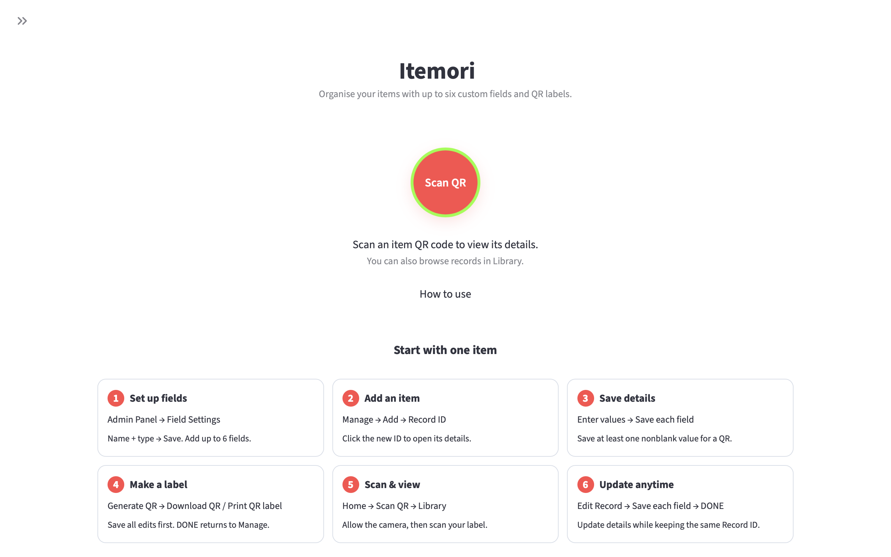
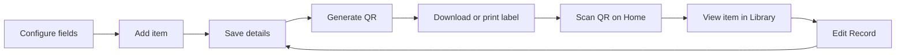
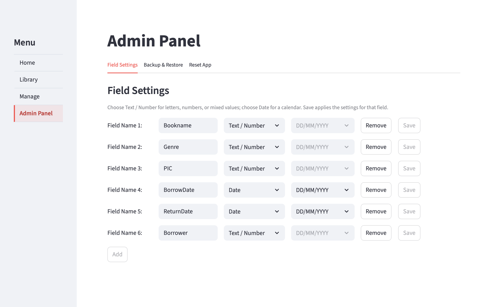
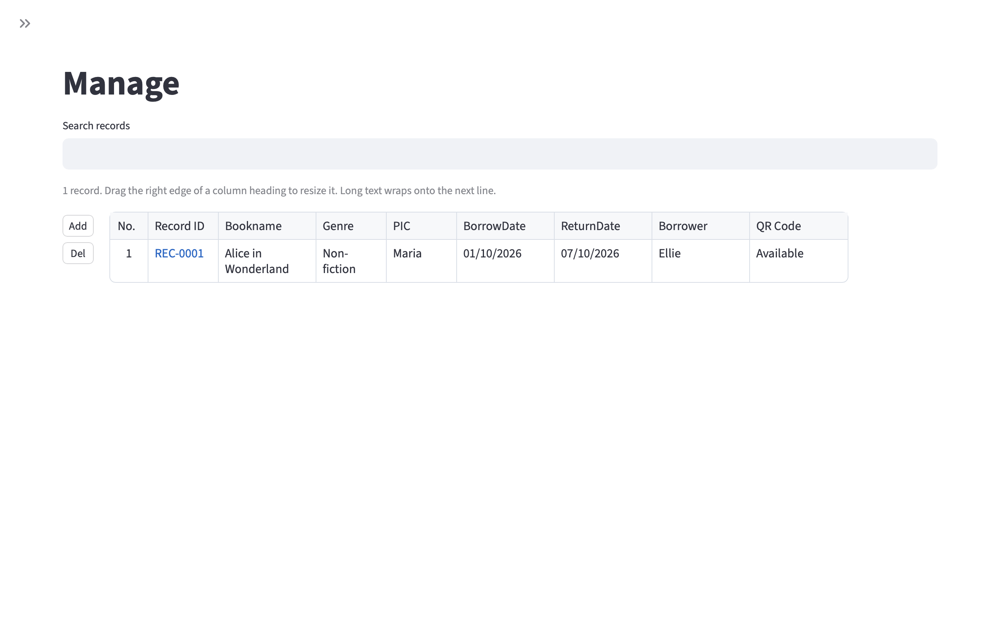
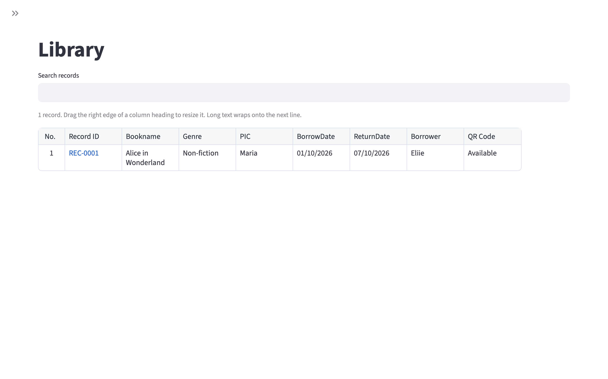

# Itemori

**Itemori - Item Record and QR Label**

Itemori (formerly QR Item Manager) helps you keep track of belongings, books,
tools, supplies, and equipment. Give each item a permanent Record ID, save its
details, generate a QR label, and scan the label to open its record.

[Download for Mac](https://github.com/syazanne/Itemori-QR_Item_Manager/releases/tag/v0.1.9-preview) · [User guide](docs/USER_GUIDE.md) · [Source code](https://github.com/syazanne/Itemori-QR_Item_Manager/tree/project-1-item-manager2) · [MIT license](LICENSE)

The Home page brings together QR scanning and a quick guide to your first item.



## How it works



## What you can do

- Choose up to **six custom fields**, with Text / Number or Date inputs.
- Add, search, view, edit, and delete item records.
- Generate QR images and printable labels with permanent Record IDs.
- Scan a QR label with your camera to open its record.
- Save records locally in SQLite.
- Export a backup ZIP and restore it when moving to another installation.

The QR contains only the Record ID, such as `REC-0001`. Editing an item's details
does not change its ID or require a new label. Use Itemori's scanner to open the
record; a general phone camera may show the ID as text.

## Get Itemori

### Mac app preview

Download package name: **`Itemori-v0.1.9-preview-macOS-AppleSilicon.zip`**.

The standalone **Itemori.app** preview targets **Apple Silicon Macs (M1 and
later), macOS 14 or later**. It includes Python and the required components,
opens in its own window, and works offline without Terminal setup.

[Download the Mac preview](https://github.com/syazanne/Itemori-QR_Item_Manager/releases/download/v0.1.9-preview/Itemori-v0.1.9-preview-macOS-AppleSilicon.zip)
and unzip it, then drag **Itemori.app** into **Applications**.
See the [release notes](https://github.com/syazanne/Itemori-QR_Item_Manager/releases/tag/v0.1.9-preview)
and [Mac guide](docs/MAC_APP.md). This preview is locally signed and not Apple-notarized;
the guide explains macOS's first-open prompt. GitHub's **Code → Download ZIP**
downloads the source code.

### Run from source

The `main` branch contains the Mac application and its source. The development
branch `project-1-item-manager2` is retained. The separate AI prototype branches
remain available for reference and are not included in the Mac release.

You need Python **3.9 or later, except 3.9.7**, a terminal, and a browser.
Internet access is needed to install dependencies; the core item manager works
locally after setup. A camera is optional, and a printer is only needed for
paper labels. No account, API key, or separate database server is required.

On macOS or Linux:

```bash
git clone https://github.com/syazanne/Itemori-QR_Item_Manager.git
cd Itemori-QR_Item_Manager
python3 -m venv .venv
source .venv/bin/activate
python -m pip install -r requirements.txt
python -m streamlit run app.py
```

Alternatively, open the source branch, choose **Code → Download ZIP**, extract
it, and run the setup commands from the folder containing `app.py`.

Open **http://localhost:8502** in your browser and keep the terminal running.
Stop the app with **Ctrl+C**. For later sessions, activate the environment and
run `python -m streamlit run app.py` again.

The published source has been tested with Python **3.9.6** and Streamlit
**1.50.0**. Dependency minimums are in [requirements.txt](requirements.txt).

## Start with one item

1. Open **Admin Panel → Field Settings** and save your field names and types.
2. Go to **Manage → Add**, then open the new Record ID.
3. Enter the item's details and **Save** each field.
4. Select **Generate QR**, then download the image or print a label.
5. Open **Home → Scan QR** to scan the label and view the item in Library.

Use **Edit Record** to update details. Save each field before leaving the page;
unsaved changes are not included in backups.

| Page | Purpose |
| --- | --- |
| Home | Scan a QR label or open the built-in guide. |
| Library | Search and view item records. |
| Manage | Add, edit, or delete records and create QR labels. |
| Admin Panel | Configure fields, use Backup & Restore, or reset the app. |

See the [step-by-step user guide](docs/USER_GUIDE.md) for field setup,
scanning, label printing, and backups.

### Configure your fields

In **Admin Panel → Field Settings**, choose the names and types of the fields
you want to record. Save each field before adding items.



### Manage your collection

Use **Manage** to add, search, and delete records. Drag a column's right edge
to resize it; long values wrap, and row numbers adjust as the displayed list changes.
Select a Record ID to edit that item.



### Edit details and create QR labels

**Record Details** lets you save each field and generate, download, or print the
item's QR label. Use **Back to Manage** or **DONE** to return to the list.


### Browse the library

Use **Library** to search and browse saved records. Select a Record ID to open
its details.



### View an item's details

**Library Details** shows the saved values and QR code together. From here,
return to Library, scan another QR, or choose **Edit Record** to make changes.


## Data and backups

Source installations store the database in `data/machines.db` and QR images in
`qr_codes/`. The Mac desktop preview stores its data separately under
`~/Library/Application Support/QR Item Manager/`; the original folder name is
retained so records remain available after the rename to Itemori.

In **Admin Panel → Backup & Restore**, create and download a backup ZIP.
Restore replaces the current collection and creates a safety backup first; it
does not merge collections. Keep downloaded backups on separate storage.
Records do not synchronize automatically between installations.

Personal databases, generated QR images, backups, Python environments, and
built applications are excluded from Git. The source repository contains no
personal collection to import automatically.

## Scope

Itemori is a local item-record tool. It does not currently provide borrowing
workflows, stock accounting, login accounts, or access roles. Library is a
read-only view, not an access-control boundary. Anyone with access to the app
can navigate to Manage and Admin Panel.

Record IDs are permanent and are not reused after deletion. Last updated shows
the latest saved change, not a full edit history. The interface is currently in
English. Lists display all matching records without pagination.

## Development

The main files are:

| Path | Purpose |
| --- | --- |
| `app.py` | Streamlit interface and navigation. |
| `database.py` | SQLite schema and record operations. |
| `field_utils.py` | Field types and date handling. |
| `qr_utils.py` / `label_utils.py` | QR images and printable labels. |
| `scanner.py` / `scanner_frontend/` | Local camera scanning and bundled jsQR decoder. |
| `backup_utils.py` | Backup validation, export, and restore. |
| `reset_utils.py` | Confirmed reset of records, fields, QR files and in-app backups. |
| `tests/` | Automated regression tests. |

Run tests from the source checkout:

```bash
.venv/bin/python -m unittest discover -s tests -v
```

Camera Reading/OCR is a private debug experiment and is not included in the
published source or Mac app. Users can start over from **Admin Panel → Reset App**
after downloading a backup if needed.

## License

Itemori's original application code and documentation are licensed under the
**[MIT License](LICENSE)** — copyright **2026 syazanne**.

Third-party components retain their own licenses. See
[THIRD_PARTY_NOTICES.md](THIRD_PARTY_NOTICES.md) and the
[dependency notices](docs/licenses/README.md).
